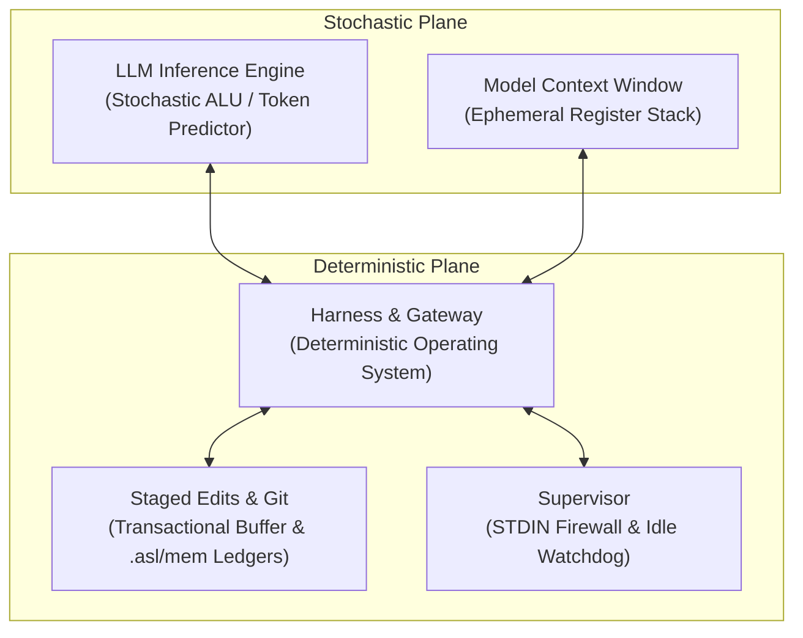

# Stop Making LLMs Do OS Work: Why Autonomous Coding Needs an ALU / Kernel Split
*By GenSEAM | September 2026*

When building autonomous software engineering agents, the prevailing industry pattern is asking the language model to act as a complete, sovereign computer.

The model is prompted to be the planner, the terminal shell, the compiler, the file system browser, the test runner, and the quality inspector all at once. When something breaks, a long stack trace is dumped back into the prompt, and the agent is asked to "figure it out."

The result is fragile:
1. **Context Drowning**: Reading whole files via `cat` fills the window within a few turns. The model loses track of its original goal.
2. **Interactive Terminal Deadlocks**: Commands hang waiting on unmonitored `stdin` prompts (`[y/N]`, sudo passwords), freezing execution until a hard timeout kills the task.
3. **Database & Memory Drift**: External vector databases store stale representations outside of Git. When a developer switches branches or rolls back a commit, the agent's memory desynchronizes from reality.
4. **Hallucinated Victory**: Models declare tasks "fixed" without running compilers or reproducing green test passes.

Our position: separate **the stochastic semantic ALU** from **the deterministic operating system**.

---

## 1. The Separation



- **The LLM is an ALU**: The model's job is probabilistic reasoning and semantic code transformation under explicit constraints.
- **The Harness is the OS**: The harness controls process lifetimes, routes tools, validates delimiters, and isolates execution.
- **The Context Window is a register file, not a trash bin**: What enters it should be chosen, bounded, and replaceable.

Much of the deterministic plane already exists as tools. The `asl` agent plane reads a symbol or a bounded slice of a file (`(:read :file ... :symbol ...)`) instead of `cat`, stages edits in a session buffer (`(:edit ...)`, `(:diff)`) and writes them to disk only on `(:flush)`, and resolves names, arity and enum coverage before anything runs (`asl/host/out/asl-host check FILE`). The rest of this post describes the parts we are still building.

---

## 2. A Slotted Context: Our Design Target

We are building the harness to partition the prompt into four registers:

| Slot | Name | Description | Retention |
|---|---|---|---|
| **Slot 1** | **Invariants** | Rules, root constraints, safety boundaries | Permanent across session |
| **Slot 2** | **Receipts Ledger** | One-line records of past actions and verifications | Compact log (`:receipt ...`) |
| **Slot 3** | **Pinned Domain Slot** | Library interfaces, type stubs, and API signatures | Loaded per step, dropped after |
| **Slot 4** | **Working Frame** | Current task and the slice of code being edited | Active turn |

The lifecycle we want for external knowledge: load the verified signatures of a library into Slot 3, let the model write against them, then drop the slot and keep only a one-line receipt:

```lisp
(:receipt :target "zod@3.22.4" :action "validated-schema" :anchor "auth.asl:42")
```

This is direction, not a measured result. We have not yet run a controlled comparison of context size or token budget with and without slotting, so we make no savings claim here.

---

## 3. Git-Native, Line-Oriented State

Traditional agent state engines rely on SQLite databases, Redis caches, or cloud vector endpoints. When multiple agents collaborate across Git branches, binary files collide.

Our working memory is plain ASN text under `.asl/mem`: `intent.asn`, `roadmap.asn`, `principles.asn`, `notes.asn`, `knownRed.asn` and dated work ledgers, versioned with the code. The `(:note)` op records and lists observations in `.asl/mem/notes.asn`. The EDDIE harness keeps only its configuration (`.eddie/config.asn`: model, provider, role routing) in the repository today.

The property we rely on is that a record is one self-contained line, so additions from parallel branches merge as line additions:

```lisp
(:edge :src "sym:store/dot" :dst "req:simdVector" :rel :fulfills)
(:edge :src "sym:paged/slab" :dst "dec:sq8Quant" :rel :governedBy)
```

Code and the facts about it commit together in one Git commit. A relational graph of use cases, requirements and edges in this form is a target; today the ledgers are flat files.

---

## 4. The Idle Watchdog

Terminal commands executed by agents frequently hang when an interactive prompt waits for input.

The process package `asl-proc` models non-interactive supervision in ASL (`asl/packages/asl-proc/src/core/process.asl`):
1. **STDIN Firewall**: the command builder redirects standard input from `/dev/null` unless input is supplied, and a timeout wraps the command in a watchdog that kills it and exits 124.
2. **Idle Watchdog**: a session tracks milliseconds since the last stdout, stderr or stdin event; any event resets it.
3. **Escalation**: `sessionStepDeadline!` sends SIGTERM after 10 s of silence and SIGKILL after 12 s, and records a receipt with the exit code (143 or 137) and a summary line.

The model then sees a structured receipt instead of a frozen terminal and can re-run with non-interactive flags (e.g. `-y`).

This is a design in code, not yet a running guarantee: on 2026-09-24, `asl/host/out/asl-host check asl/packages/asl-proc/src/core/process.asl` exits 1 because `execCmd` and `file-write` are not bound on the stage-0 host, so the module does not load there yet.

---

## 5. What We Have Not Measured

An earlier version of this post carried a solve-rate table comparing a 31B model and a 3B model inside this harness with a frontier model in a raw shell. No run, lock or result file backs those numbers, so we removed them. We record headless client runs, one line per run with pass, token and turn counts, in `tests/harnessBench/ledger.asn`; a solve-rate comparison will be published from such a ledger, with its method, scope and date, or not at all.

---

## 6. Conclusion

Our working hypothesis is that much of what makes autonomous software engineering unreliable is an **operating system architecture problem**, not only a model capability problem.

When models are relieved of bookkeeping, file traversal, and unconstrained shell execution, and instead work through bounded reads, staged edits, checks that run before code does, and process supervision, the remaining failures are the ones worth a model's attention. That claim is testable, and the ledger above is where we intend to test it.

- Explore [The Agent Operational Circle](/blog/the-agent-operational-circle).
