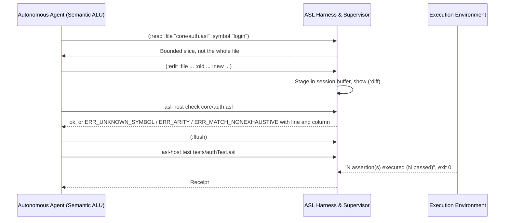

# Why Bash Wrappers Fail Coding Agents: Action Loops and Checks That Run Before Code Does
*By GenSEAM | September 2026*

When building developer tools, compilers, and harnesses for autonomous software engineering agents, the prevailing industry approach is wrapping standard command-line tools in raw bash subprocesses.

The agent is given a shell prompt and asked to navigate multi-file repositories using tools designed for humans: `cat`, `grep`, `npm test`, `cargo build`, and interactive prompts. When a command fails, thousands of lines of unformatted compiler output flood the context window, and the agent is left to guess how to proceed.

The result is operational fragility:
1. **Interactive Deadlocks**: Commands freeze when waiting for unseen `stdin` prompts (`[y/N]`, sudo, or pagers like `less`).
2. **Subshell Ephemerality**: Directory changes (`cd`) and environment exports (`export VAR=val`) disappear between turns, so agents repeat failed setup steps.
3. **Foreign Dependency Drift**: Multi-language projects break when host environments drift across Python, Node, Rust, or C toolchains.
4. **Weak Feedback Loops**: A check that passes when it should fail teaches the agent to declare success.

Tools for agents should match how language models operate. This post describes the loop we are building for AgentScript (ASL), the checks that already exist, and where they are still weaker than they look.

---

## 1. The Action-Observation Loop

Human engineers use a terminal as an interactive loop with visual inspection. Coding agents work in discrete turns of action and observation. The loop we are building:

### Operational Properties
1. **Bounded reads**: `(:read)` returns a symbol or a bounded slice; `asl intel outline FILE` lists a module's functions and signatures without loading bodies.
2. **Staged edits**: `(:edit)` and `(:write)` stage changes in a session buffer; `(:diff)` shows them; `(:flush)` writes them to disk together and `(:discard)` drops them.
3. **Non-interactive execution** (in progress): the process package `asl-proc` redirects standard input from `/dev/null` by default, and models an idle watchdog that sends SIGTERM after 10 s of silence and SIGKILL after 12 s, returning a structured receipt. That module does not yet load on the stage-0 host (on 2026-09-24 `asl-host check` reports unbound `execCmd` and `file-write`), so it is a design in code rather than a running guarantee. Persisting working directory and environment across turns is likewise a target.

---

## 2. Checks That Fail on the Claim

A check is only useful to an agent if it fails when the code is wrong. The ASL toolchain has two engines, and today they differ on exactly that point:

- **The stage-0 host** (`asl/host/out/asl-host check FILE`, `asl-host test FILE`, and `asl run`) resolves every name before anything runs. An unknown symbol, a wrong argument count, or an `mt` that misses an enum case is an error with line and column. A test passes only when the exported `runTests` returns `true` after at least one assertion executed.
- **asl-core** (`asl check`, `asl test`, `asl eval`) is lenient: `asl check` verifies delimiter balance only, and `asl test` treats an unknown name as data and passes a `runTests` that returns `false`.

A concrete example, run on 2026-09-24: a file with a top-level `(defun double [x] (* x 2))` fails `asl-host check` with `ERR_UNSUPPORTED_TOPLEVEL list-form (defun ...) at top level` (exit 1), while `asl check` on the same file reports `audit check: passed` (exit 0). `lambda` is not a hallucination on either engine; the host accepts it as `fn`.

So the agent-facing rule is simple: check and test with the host.

---

## 3. The Gate Suite

Workspace-level verification runs through one command, `./bin/asl audit gates --full --sync`. Without `--full` it runs the static checks only. On 2026-09-24 that static run took about 9 s wall-clock on a local macOS machine and reported 19 checks passed with status `:pending`, because the 816 test suites had not been executed. The static checks include:

| Check | What it verifies (count from the 2026-09-24 run) |
| :--- | :--- |
| `gate1Manifests` | package manifests (65) |
| `gate2Syntax` | delimiter balance across source files (3,048) |
| `gate3Grounding` | the published-claims registry (12 entries) |
| `gate4Foreign` and `foreign*` | foreign-language files against an allowlist and a baseline that grows only by a recorded raise (453 entries) |
| `gate6GrammarCount`, `c2Emoji` | grammar registry shape; no emoji in sources |
| `gate7Skill`, `gate7Rules`, `gate7Installer` | skills, rendered rules, and installer identity |

With `--full`, the suites run as well. A suite that fails is red unless it is listed with its digest in `.asl/mem/knownRed.asn`, and that list may only shrink. Two caveats matter. First, the gate runner's own logic lives in a binary without tracked source, so its green banner is not by itself authoritative; we treat a gate as real only when a seeded defect makes it fail. Second, many suites still run on the lenient engine. Moving them to the host is the current work.

`asl gate` and `asl lint` also exist as commands, but today they print a fixed success line without running checks; do not use them as verification.

---

## 4. Coverage

An earlier version of this post claimed 100 percent function coverage across the packages. No coverage command or measurement exists, so the claim is withdrawn. The nearest real tool is `asl '(:intel :op :vacuity)'`, which scans test files for suites that return without executing an assertion. Function-level coverage is a target.

---

## 5. One Language in the Packages

A repository that mixes Python test scripts, TypeScript transpilers, Rust binaries, and Bash glue asks an agent to master several package managers, build systems, and diagnostic formats.

Inside `asl/packages` (46 package directories on 2026-09-24), every tracked file is `.asl`, `.asn` or `.md`, apart from three `.gitignore` files. The toolchain around them is not yet pure: `bin/asl` is a bash script with embedded Python, and `./bin/asl audit foreign` counts 453 allowlisted foreign files (77,975 lines on 2026-09-24) each held to a baseline that may grow only by a recorded, dated raise. Replacing them with ASL is the direction.

The benefit we are after:
1. **One cognitive domain**: the agent reads and writes one syntax.
2. **No dependency breakage**: a package with no `node_modules` or virtualenv has nothing to drift.

---

## 6. The Toolbelt

| Command | Purpose |
| :--- | :--- |
| `asl/host/out/asl-host check <file>` | Resolve names, arity and enum coverage before running. |
| `asl/host/out/asl-host test <file>` | Strict test runner: `runTests` must return `true` after at least one assertion. |
| `asl check <file>` | Delimiter balance only (asl-core). |
| `asl test <file>` | Lenient runner on asl-core. |
| `asl intel outline <file>` | Functions and signatures of a module without bodies. |
| `asl audit gates --full --sync` | The workspace gate suite. |
| `asl '(:read ...)' '(:edit ...)' '(:flush)'` | Bounded reads and staged edits on the agent plane; `asl '(:tools)'` lists every op. |

---

## 7. Conclusion

Autonomous coding is not only about model weights or prompts; it is about **tooling architecture**. The parts that help most are the plain ones: bounded reads, staged edits, and checks that fail on the claim. The parts that look like help but are not, such as a gate that always passes, are worse than no gate at all, because the agent trusts them.

- Learn about token ergonomics in [The Token-Density Fallacy](/blog/the-token-density-fallacy-and-machine-understandability).
- Run the strict checks: `asl/host/out/asl-host check <file>` and `./bin/asl audit gates --full --sync`.
