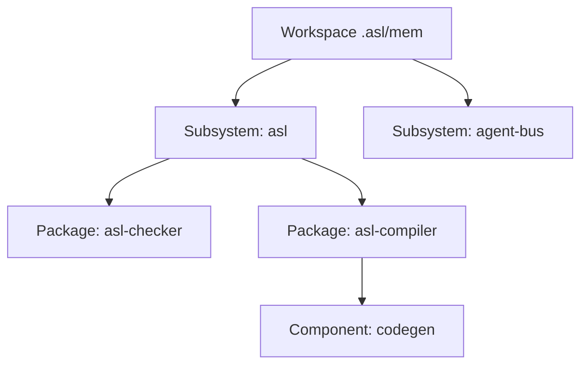

# Beyond Flat Context: Tiered Memory and Tree Aggregation in AgentScript
*By GenSEAM | September 2026*

When designing memory architectures for autonomous software development agents, the prevailing industry default is a flat context dump.

An agent is dropped into a repository, and whenever it needs context, external tooling either dumps entire files into the prompt (`cat`, `view_file`) or injects loose Markdown notes and vector chunks into a single monolithic memory buffer.

When a repository grows from a single script into many subsystems and packages, flat context breaks down:
1. **Context contamination**: large dumps of unrelated source code crowd out working memory and invite hallucinations.
2. **Attention dilution**: constraints buried in the middle of a long prompt are easy for a model to miss.
3. **Repeated cost**: every reasoning step re-reads the same structural data.

Some systems answer with a **two-tier memory model**: "global" repository memory and "local" package memory.

Real systems are not two-tier. A workspace contains subsystems, packages, internal sub-packages, and modules. A binary global/local split either leaks package-level decisions into the global store or hides them where no one looks.

This post describes the memory we run today in AgentScript (ASL), and the recursive, tiered design we are building toward.

---

## 1. Today: Plain Ledgers, One Directory

Our memory is plain ASN text under `.asl/mem` at the workspace root, kept beside the code it describes. The tools know a handful of ledger kinds:
- `intent.asn` and `roadmap.asn`: what the work is for and what comes next.
- `decisions/decisions.asn`: decision records with their rationale.
- `notes.asn`: observations, written and listed with the `(:note)` op.

The ops that touch it are confined to it. `(:mem :op list|get|query|put ...)` reads and stages row-keyed ledger changes, and a path that leaves `.asl/mem` is rejected with `ERR_BOUNDARY_VIOLATION`. `(:note :action :list)` reports the notes ledger, and `asl '(:observe :dim memory)'` reports ledger sizes; the old `asl mem` command is retired in its favour.

The ledgers are workspace state, not part of the published language repository: a fresh clone of it has no `.asl/mem`, and `(:note :action :list)` there answers `:status :empty`. Today there is one tier, the workspace that holds the working directory.

---

## 2. The Target: Self-Similar Tiers at Depth N

The design we are building extends that one directory into a recursion:

```text
Tier 0 workspace -> Tier 1 subsystems -> Tier 2 packages -> Tier 3 components -> Tier 4 modules
```



Three properties define it:
1. **Self-similarity**: every node uses the same memory schema (intent, decisions, invariants, knowledge), so a tool that reads one tier reads them all.
2. **Local ownership**: a decision made inside a package is recorded in that package's memory and reaches the root only when an upper tier aggregates it.
3. **Inheritance**: a child tier inherits its parent's constraints unless it records an explicit, reasoned override.

Only the root tier exists today; ledgers below it are the next step.

---

## 3. Memory as Code

In most systems memory is passive text: Markdown, JSON, or embeddings. An agent reads it, translates it, and writes glue to apply it.

In ASL, memory records are S-expressions, the same syntax as the code, and a function is a value that a record can hold. An invariant can therefore carry its own check. This runs on the stage-0 host today:

```asl
(module probe/invariant :x [Invariant noDoubleComment zeroComment holds runTests])

schema Invariant
  id: String
  scope: String
  predicate: (Fn [String] -> Bool)

fn noDoubleComment source: String -> Bool
  (not (stringContains? source ";;"))

fn zeroComment -> Invariant
  {:id "C0001" :scope "asl/packages/asl-checker" :predicate noDoubleComment}

fn holds inv: Invariant source: String -> Bool
  (let [(p inv.predicate)] (p source))

fn runTests -> Bool
  (do
    (assert (holds (zeroComment) "(+ 1 2)") "clean source holds")
    (refute (holds (zeroComment) ";; note") "commented source fails")
    true)
```

`host/out/asl-host test` on this file prints `1 assertion(s) executed, 1 refutation(s) executed (2 passed)` (2026-10-14). Today our ledgers hold data, not predicates; storing executable invariants in `.asl/mem` so that a gate can evaluate them directly is part of the design.

---

## 4. Logical Addresses (Target)

Physical paths are host-specific: they change when a package moves or runs inside a browser's virtual file system. The design adds logical memory addresses resolved by a small resolver:
- `mem:root/intent`: the workspace intent.
- `mem:asl/checker/invariants`: the checker package's invariants.

The resolver would look in an in-memory cache first and hydrate from the tier's `.asl/mem` files on a miss, so the agent names what it wants and the storage can be the local disk, a Git snapshot, or a browser file system. None of this is implemented yet; today tools address memory by workspace-relative path.

---

## 5. Aggregation (Target)

Focused work wants local memory; coordinators and humans also want the whole picture. The aggregation we are building walks every tier and emits one compact ASN stream, for example:

```lisp
(:memorySnapshot
  :tiers 2
  :subsystems [
    (:subsystem :name "asl" :path "asl" :memory "asl/.asl/mem")
  ]
  :status :consistent)
```

The shape above is illustrative; no command produces it yet. When it ships it will be an agent-plane op listed by `asl '(:tools)'`.

An earlier version of this post printed a tree and a comparison table (token cost per turn, pollution rate, scan time, pass rate) for flat, two-tier and fractal memory. No run backs those figures, so we removed them. We will publish a comparison when it comes from a recorded run with its method, scope and date.

---

## 6. Conclusion

Memory for an agent is not a key-value store or a pile of notes. It is the structure through which the agent sees the system. Our current memory is deliberately plain: line-oriented ASN ledgers in one directory beside the code. The recursion, the logical addresses and the aggregation are where it is going, and each will be described as shipped only when a command does it.

- Explore test runners and what they report in [Test Telemetry](/blog/zero-overhead-test-telemetry-and-resource-observability).
