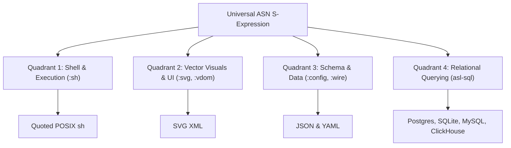

# The Single Grammar Doctrine: Why Multi-Agent Systems Need One Homoiconic Notation
*By GenSEAM | September 2026*

When building autonomous AI coding agents, engineering teams tend to recreate the Tower of Babel inside the model's context window.

During a single coding task, an agent juggles several mutually incompatible syntaxes:
1. **Configuration**: JSON (comma drift, bracket mismatches) and YAML (invisible whitespace, indentation failures).
2. **Visual Output & Markup**: raw SVG XML and HTML, where models spend output budget on attribute boilerplate and can truncate mid-tag.
3. **Command Execution**: Bash and POSIX shell strings, where nested quotes, dollar expansions and pipes cause silent failures and shell injection.
4. **Data Querying**: SQL dialects (SQLite, Postgres, DuckDB) with divergent string-escaping and type-casting rules.

Each switch is a new set of escaping and closing rules for the model to get right. We have not measured what share of agent tokens or task failures this costs; the claim of this post is architectural. To keep long autonomous runs reliable, we want to close **The Agent Operational Circle**: one notation the agent writes, rendered to whatever format the outside world needs.

---

## 1. The Four Quadrants of Autonomous Operation

The design goal: the agent does not write raw JSON, YAML, SVG, HTML or Bash. It writes **AgentScript Notation (ASN)**, and renderers produce the external format.



Every quadrant shares the same syntactic rules:
- **One Delimiter Rule**: every expression is enclosed in balanced `(...)`, and an unbalanced form is caught by a balance check (`asl '(:check :file "...")'`) before anything evaluates it.
- **Short Keywords**: attributes and verbs are short keywords (`:cmd`, `:args`, `:rc`, `:circ`, `:f`, `:s`).
- **Rendering as Library Code**: the renderers are ASL functions in the repository, listed per quadrant below with their test status on the stage-0 host on 2026-10-14.

---

## 2. Quadrant 1: Structured Shell Execution (`:sh`)

### The Fragility of Shell Strings
Prompting an LLM to generate `bash -c "..."` invites trouble. A command like:
```bash
find packages -name "*.asl" -exec grep -l "TODO" {} + | xargs wc -l
```
is exposed to unescaped quotes, glob misinterpretation, BSD (macOS) versus GNU (Linux) differences, and pipelines that fail silently without `set -eo pipefail`.

### The ASN Form
In ASN, a command is data with an explicit argument vector:

```asn
(:sh :pipe
  (:cmd "find" :args ["packages" "-name" "*.asl"])
  (:cmd "wc" :args ["-l"]))
```

This form is not shorter: tiktoken 0.12.0 counts 34 tokens for it against 12 for the equivalent `find packages -name "*.asl" | wc -l` (both `o200k_base` and `cl100k_base`, 2026-09-24). What it buys is that every argument is a separate string, so quoting is the renderer's job, not the model's.

What exists today:
1. `asl/packages/asl-target-sh/src/emitSh.asl` prints POSIX sh with single-quote quarantine: a literal `it's safe` becomes `'it'\''s safe'`, `$(rm -rf /)` becomes `'$(rm -rf /)'`, and a variable becomes `"${user_input:-}"`. Its suite `asl/packages/asl-target-sh/tests/emitShTest.asl` passes on the host (`asl-host test`: 12 assertions, 1 refutation).
2. `asl/packages/asl-transpile/src/shTranspile.asl` (`asnToSh`, `shToAsn`) converts between the `:sh` form and script text; its suite passes on the host with 22 assertions.

Executing an argument vector directly through `execve`, with no shell in between, is the direction we are building toward; today the output is a script.

---

## 3. Quadrant 2: Vector Graphics and Visual Output (`:svg`)

### The SVG XML Token Tax
When generating icons, UI cards or diagrams, raw XML repeats attribute names on every element (`x1="..."`, `y1="..."`, `stroke-width="..."`), and on large drawings a capped generation can end mid-element.

### The ASN Form

```asn
(:svg :w 400 :h 400
  (:circ :cx 200 :cy 180 :r 80 :f "#ff00cc")
  (:rc :x 120 :y 140 :w 160 :h 5 :f "#050510")
  (:rc :x 120 :y 150 :w 160 :h 8 :f "#050510")
  (:ln :x1 0 :y1 300 :x2 400 :y2 300 :s "#00ffff" :sw 2)
  (:ln :x1 200 :y1 300 :x2 200 :y2 400 :s "#00ffff" :sw 2))
```

This drawing costs 151 tokens against 172 for its hand-written SVG equivalent on `o200k_base` (12.2 percent fewer; 151 against 171 on `cl100k_base`). Two renderers turn it into SVG: `asl/packages/asl-vdom/src/asnSvg.asl` and `asl/packages/asl-transpile/src/svgTranspile.asl`; their suites pass on the host (`asnSvgTest` 27 assertions, `svgTranspileTest` 62). The SVG they emit can then be rasterized by standard tools such as `resvg` or `librsvg`. [Why LLMs Choke on SVG XML](/blog/why-llms-break-on-svg-xml) has the details.

---

## 4. Quadrant 3: Configuration & Wire Frames (`:wire`)

Why write JSON or YAML when you can write ASN?
- **JSON overhead**: quoted keys, commas, braces and colons.
- **YAML drift**: indentation bugs that change the tree.

ASN writes configuration and inter-agent frames as keywords and values:

```asn
(:wire :msgId "w-901" :op :taskPropose
  :target "worker-4"
  :payload (:task "runGate" :strict true :timeoutMs 10000))
```

This frame costs 44 tokens against 52 for the same record as JSON (`json.dumps` with default separators), on both `o200k_base` and `cl100k_base`: 15 percent fewer. Converters exist in `asl/packages/asl-transpile/src/transpile.asl` (`jsonToAsn`, `asnToJson`, `yamlToAsn`, `asnToYaml`); its suite passes on the host with 81 assertions, and the YAML converter's own suite with 42.

---

## 5. Measured Across the Circle

The three examples in this post, counted with tiktoken 0.12.0 on 2026-09-24 over the exact text shown (ASN form against the external form):

| Example | External Format | ASN (o200k) | External (o200k) | Change |
| :--- | :--- | :--- | :--- | :--- |
| **Shell pipeline** (section 2) | Bash string | 34 | 12 | ASN costs 22 more |
| **Vector drawing** (section 3) | SVG XML | 151 | 172 | 12.2% fewer |
| **Wire frame** (section 4) | JSON | 44 | 52 | 15.4% fewer |

Three hand-picked examples are not a benchmark, and we have not measured failure rates for either form. They show the trade: ASN is cheaper where the external format repeats keys and closing tags, dearer where the external format is terse, and structurally uniform everywhere.

---

## 6. Closing the Loop

Autonomous agents should not have to be interpreters for a stack of human-oriented serialization formats.

By writing data, markup, visuals and commands in one S-expression notation, the model spends its capacity on the task instead of on each format's escaping rules, and the renderers carry those rules once, in code that can be tested.

- Read [Why LLMs Choke on SVG XML](/blog/why-llms-break-on-svg-xml).
- Explore [Against Agent Framework Bloat: The Case for Radical Simplicity over Large Orchestrators](/blog/kill-80-percent-agent-code-bloat).
